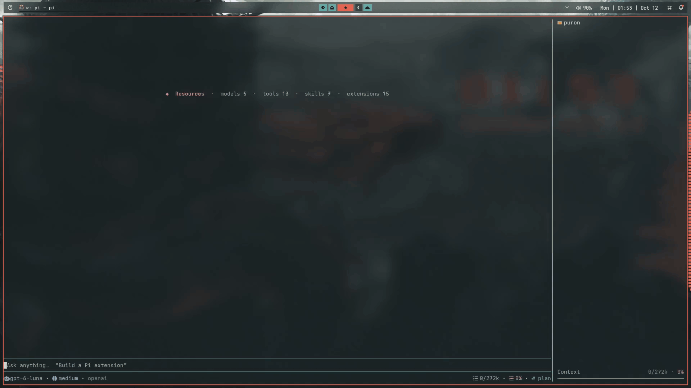

# sleek-ui

Make Pi feel more like your workspace. Sleek brings a calmer, more personal look to Pi’s terminal interface, with thoughtful themes, clearer tool previews, and useful session details—all in one extension.




## Install

From the repository folder containing `sleek-ui/`, run:

```bash
pi install ./sleek-ui
```

This personal install loads Sleek from that folder, so keep it in place. Restart Pi or run `/reload` to activate it. Review the source before installing; extensions run with Pi’s operating-system permissions.

## Get started

Run `/sleek` in Pi to open Sleek’s settings menu. Use arrow keys to browse settings, and Enter to choose an option. Most changes apply immediately.

Press **Ctrl+\\** to show or hide the side panel. Use **Ctrl+O** where available to expand a collapsed tool or task preview.

## What it does

- **Themes and message styles:** includes 24 bundled themes and lets you choose how user and assistant messages look. The `Terminal` theme follows your terminal’s colors. Disable **Theme background** in `/sleek` if you use a transparent terminal.
- **Tool display:** choose compact or expanded tool blocks, animate working details, and view edits in a side-by-side diff. Large diffs may collapse or omit syntax highlighting.
- **Thinking and startup:** choose animated working indicators and logo effects, customize the home screen, and show a placeholder while the session is empty.
- **Status bars:** choose Sleek, Bar, Minimal, or Pi’s default footer. Select which context, token, cost, model, and Git details appear where supported.
- **Task and agent side panel:** view tasks, delegated agents, project and usage information when compatible task or agent tools provide it. It hides automatically below 100 terminal columns. Sleek displays this information; it does not create tasks or agents.
- **Notifications:** choose when Pi should alert you that a response is ready. Notification and sound support depends on your desktop environment and helper programs, described below.
- **Response details:** completed replies automatically show elapsed time and, when available, cost and speed. This footer currently has no off switch.
- **Image previews:** a user message that references or attaches an image (for example a pasted clipboard file like `/tmp/pi-clipboard-….png`) renders an extra preview block just below the message with the image name and location, an inline terminal image when the terminal supports one, and **View** / **Save to Downloads** actions. Attached images with no file path are labeled **Clipboard**. The inline image follows Pi's own **Show images** setting; **View** opens the file with your system viewer and **Save to Downloads** copies it into `~/Downloads` without overwriting an existing file.
- **Cleaner fullscreen copying:** keep the same visual styling without copying message rails/frames, reply metrics, status bars, sidebar dividers/task separators, or Sleek editor borders/placeholders/autocomplete. Screen selections stay within their starting pane; side-by-side diff copies use the starting column without its line-number gutter.

## Compatibility and notes

**Sleek is intended for Pi's fullscreen TUI mode.** Mouse-driven controls — such as the image-preview **View** / **Save to Downloads** actions and tool expansion clicks — need fullscreen mode; in regular mode the terminal owns scrolling and mouse input, so those controls may not respond. Inline image previews additionally need a terminal that supports the Kitty or iTerm2 image protocol; without one, the preview block shows a hint instead of the image and the actions still work.

Sleek targets **Pi 1.1.x**. A Nerd Font is recommended for some interface icons; without one, those symbols may look different.

Desktop alerts use `notify-send`; sound uses `pw-play`, `paplay`, or `canberra-gtk-play`. The sound-file picker uses `zenity` or `kdialog`. These optional desktop tools are commonly available on Linux; alerts may not work without them. Focus-aware alerts also depend on the terminal reporting when it is focused. Notifications can include excerpts from replies or details from questions and permission prompts, so consider your desktop’s lock-screen and notification privacy settings.

The side panel needs compatible task or subagent tools to show those items. Live activity requires Sleek in a compatible in-process child session; separately launched agents may not provide it. The panel hides on narrow terminals; use `/sleek` settings to manage its sections and tasks.

Sleek customizes how tools are displayed; it does not replace Pi’s execution or sandbox. If another extension has already taken control of the editor, Sleek leaves that editor in place.

## Selecting and copying text

Normal mouse selection in **Pi fullscreen mode** omits Sleek-generated decorations while preserving real text, symbols, and code indentation. There is no extra setting; the cleanup applies automatically. Double-click word selection and triple-click line selection still use Pi's native selection behavior. Decorations can remain highlighted visually even though they are omitted from the clipboard.

For side-by-side edit diffs, start in the **old** or **new** column to copy that version. Very narrow terminals retain the compact combined diff representation rather than separate selectable columns.

**Regular mode and terminal-native selection (such as Shift-drag) are unchanged:** the terminal copies visible characters, including UI decorations. Other extensions' decorations and Pi's own Markdown/code-block chrome are not filtered. If another extension owns the editor, Sleek leaves it—and its copy behavior—alone.

## Settings

Settings are stored in `~/.pi/agent/sleek.json`. Use `/sleek` for the common options, including themes, message styles, density, animations, status bars, notifications, and side-panel sections. Advanced options can be edited in the settings file; restart Pi or run `/reload` afterward.

## License and theme credits

The extension is MIT-licensed. Bundled themes include third-party work; see [`themes/README.md`](./themes/README.md) for their credits and licensing.
